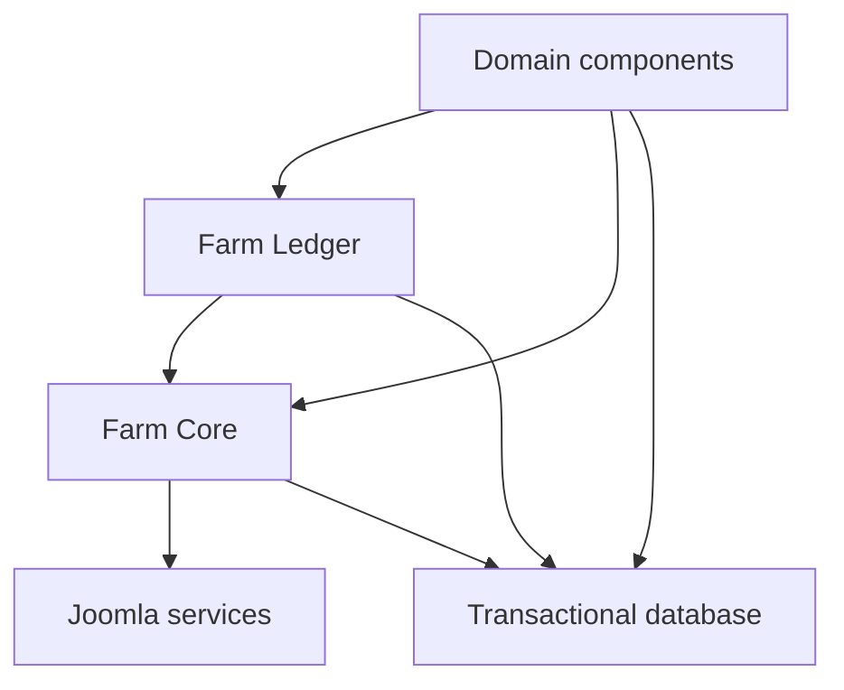

# Architecture and component ownership

## 1. Chosen shape

Build a **modular Joomla application**: seven JCB-authored components, one Joomla installation, one legal entity, and one transactional database. Domain components use explicit in-process contracts. External services are adapters and are never required to complete an ordinary on-farm stock transaction.

This is a proposed architecture, not a claim that installing JCB provides an ERP transaction framework. JCB-native authoring and validation rules come from the [skills operating contract](https://github.com/joomengine/skills/blob/b3f79efe7e83f40aa2a5236844277dd9b67eb60e/AGENTS.md), [request workflow](https://github.com/joomengine/skills/blob/b3f79efe7e83f40aa2a5236844277dd9b67eb60e/workflows/request-to-extension.md) and the detailed [build guide](jcb/JCB_PLAYGROUND_BUILD_GUIDE.md).

## 2. Seven components

| Component | Authoritative responsibilities | Must not own |
| --- | --- | --- |
| `com_farmcore` | Organisation, farms, locations, enterprises, parties, products, units, currencies, external references, access scope, private file registry, audit, command receipts, source-independent daily workspace and common infrastructure | Satellite domain tables, balances, journal lines, booking availability |
| `com_farmledger` | Warehouses, lots, stock quantities/valuation/reservations, purchasing/sales documents, tax and FX posting snapshots, payments, receivables/payables, GL, bank reconciliation, budgets and financial asset schedules | Animal biology, crop activities, recipe execution, room availability, employment records |
| `com_farmlivestock` | Animals and identifiers, herds/flocks, membership, breeding, weights, treatments/withdrawals, mortality and livestock movement workflow | Independent feed stock, invoices, tax, GL or official permit issuance |
| `com_farmcrops` | Plots/beds, crop cycles, soil/field observations, crop activities, input applications, irrigation and harvest/grade records | A second stock system or a recipe engine |
| `com_farmmake` | BOM/recipe revisions, production orders, work operations, material genealogy, actual yield, quality release, rework and recall coordination | Independent procurement, customer balances or employee wage calculations |
| `com_farmstay` | Physical accommodation and bookable resources, holds/reservations, guests, stay/hunt packages, guides, hunting eligibility and quota allocation, trophy/dispatch evidence | Financial invoice/payment records, authoritative wildlife census or government licences |
| `com_farmwork` | Worker/contractor records, work/attendance/leave, equipment/assets in operation, maintenance, meters, fuel/water observations, inspections and incidents | Payroll legislation engine, stock/fuel balances, financial depreciation ledger |

The trading/stock/accounting owner is deliberately broad: inventory valuation, invoicing and accounting frequently need one atomic posting. Its internal code remains split into focused services and repositories. Domain modules stay independently understandable. Splitting the ledger into separate extensions is a future decision only if it preserves the same guarantees.

## 3. Dependency direction

Here `Domain components` means livestock, crops, make, stay and work. They depend on Core and, for stock or money operations, Ledger. No satellite requires another satellite to install. Optional integration uses an advertised capability contract: for example Make can use a crop harvest lot without depending on Crops, because Ledger owns the lot and Core holds its product.

Core never boots a missing satellite to build its dashboard. Installed providers register read-only cards/queries through a versioned capability registry. A missing provider removes its card and actions. Core writes nothing to domain tables and cannot convert a dashboard query into a backdoor command.

Install order is Core → Ledger → selected domains → any JCB-authored integration/task/webservices plugins needed by those features. Reverse uninstall is blocked while dependencies or retained business records exist; uninstall must never imply permission to erase business data.

## 4. Runtime placement and dependency injection

Use the target Joomla extension service-provider and child-container conventions; Joomla documents how each extension registers its services in a child container and resolves dependencies ([official DI guidance](https://manual.joomla.org/docs/general-concepts/dependency-injection/extension-child-containers/)). JCB's Power placement and loaders must be proved on the actual compiler.

Working namespace ownership:

- Component-specific classes use their own component namespace.
- Cross-component public contracts and shared implementations have **one owner: Core**. Satellites reference them and do not install conflicting copies under a shared global namespace.
- Ledger exposes a small public service facade. A thin generated owner-model adapter may delegate to that facade when this is the supported native bridge; arbitrary base-model saves/deletes and SQL are not its business API. Do not assume an unimplemented `getService()` or public component-container method exists.
- Interfaces cover a concrete need: scope checking, stock posting, financial posting, private file access, command execution and clocks. Do not wrap every generated getter.

**R0 gate:** prove the supported JCB method for shipping/loading the shared contracts from Core, obtaining owner services through the component extension, preventing duplicate class definitions, checking compatible versions, and surviving upgrade/uninstall. A compiled class in `/libraries` is not evidence of correctly owned installation. If this cannot be achieved natively, stop expansion and document the supported alternative; do not hide an independently maintained PHP package outside JCB.

## 5. Source of truth and normal CRUD

Native JCB Fields and Admin Views define each separately persisted entity. Conventional forms and Dynamic Gets handle normal master-data CRUD and structured reads. Custom Admin Views/Site Views provide operational presentation; Templates and Layouts share rendering. JCB-authored Powers implement nontrivial rules and supported hooks connect real callers.

For immutable financial, stock and booking effects, generic CRUD is **not** the write interface. Command services enforce allowed transitions, field allowlists, role/scope, expected version and invariants. A generated list/view may inspect these rows; direct edit/delete/bulk/trash/save-as-copy endpoints are denied. Joomla administrator privilege does not make a malformed stock journal valid.

Generated endpoints require explicit route inventory and tests. Joomla ACL viewing access and action permission are distinct concepts; extension authors must check the appropriate permissions ([Joomla ACL](https://manual.joomla.org/docs/general-concepts/acl/)). Farm scope is an additional application filter applied to every read and command, including modal selectors and file retrieval.

## 6. Transaction ownership

All business writes use a single transactional database connection per command. One outer **Unit of Work** owns begin/commit/rollback. Repositories and participating owner services never commit independently. They receive the transaction context; a second connection or internal commit is a failing architecture test.

Example: complete a production batch.

1. Authenticate actor; load current scopes, command receipt and expected production version.
2. Lock the production order, required lot/balance rows and relevant accounting period in a deterministic order.
3. Validate input availability, quality/withdrawal restrictions, quantity/yield rules and accounting configuration.
4. Make records execution/yield and immutable genealogy; Ledger records consumption, outputs, valuation and, in accounting mode, journal lines; Core records audit and outbox rows.
5. Transition the order to completed and persist the command result in the same transaction.
6. Commit once. Only then may a worker deliver notifications or integrations.

Any failure before commit rolls back every effect. A timeout after commit is resolved by retrying the same command key; the stored result is returned without posting twice. PDF generation and email delivery do not occur inside the database transaction. Transactions that span network services are out of scope.

DDL migrations are not covered by ordinary business rollback. Plan and verify them separately in the deployment process.

## 7. Concurrency and idempotency

- Every mutable aggregate has an integer version checked on update; forms include that version and show a useful conflict message.
- Commands have client-generated UUID request keys, server-computed canonical payload hashes and a unique `(organisation_guid, command_type, request_key)` receipt. Reusing a key with different content is a conflict.
- Immutable effects have natural uniqueness too: `(source_type, source_guid, source_line_guid, effect_kind, revision)` or a documented equivalent. HTTP retries are not the only duplication source.
- Lock stock balance rows before checks. Creation of an absent balance row must use a unique key plus a race-safe insert/lock sequence. Use a canonical non-null `balance_key`; a composite unique key containing nullable lot/bin fields is insufficient. Validate the canonical tuple and keep its dimensions available for inspection.
- Reservations initially lock the existing physical resource rows in sorted GUID order and check all overlapping night/slot claims under those locks. This conservatively serializes each resource without inventing an absent capacity table. A later per-resource/night lock table requires an explicit model and new proof. Do not assume the SQL engine supplies partial or exclusion indexes. Displayed availability is advisory until the server commits a claim.
- Retry a whole rolled-back transaction only for classified transient failures. Never retry a partially committed inner service or ignore a unique-key error.
- Use fixed lock ordering and bounded retries; log contention without personal data. Contract tests include simultaneous requests on the production database engine.

## 8. Identity, scope and time

Each runtime record retains a Joomla numeric primary key and, where appropriate, an immutable application GUID used for business relationships and portable interchange. These GUIDs differ from the JCB definition GUIDs used to compile that table. External tag numbers, document numbers and product codes are mutable or governed business identifiers, not substitutes for row identity.

The installation has one organisation row. Operational records carry explicit farm and enterprise/cost-centre scope or a declared organisation-wide classification. Null must not accidentally mean access to every farm. Users with multiple farm scopes select the intended farm before recording an event.

Store instants in UTC with an original local timezone context; store business dates as `DATE`, not midnight UTC. Reservation nights use the property's local date. Store date of birth with precision/estimated flags where only a month/year is known. Country packs choose an IANA timezone, not a hardcoded offset.

Money uses decimal arithmetic and persisted currency codes; never PHP floating point for postings. Exchange rates and unit conversions are effective-dated and snapshotted on transactions. Detailed precision and rounding policy is in [finance and stock](FINANCE_STOCK_AND_COSTING.md).

## 9. Events, integrations and reporting

Cross-component state changes that must be atomic use synchronous owner services. Events are durable facts **after** the transaction, delivered from an outbox for email, exports and derived reporting. Consumers keep deduplication keys and support retries and dead-letter review. An event consumer does not invent a missed financial posting.

Use typed, versioned event payloads with source GUID, actor, correlation ID, schema version and UTC occurrence. Keep personal details out unless needed by the destination. Transport authentication, signatures and retries are adapter responsibilities.

Reports query owner-authorised read models. Precomputed projections are labelled with an as-of watermark and can be rebuilt from the authoritative records. They cannot become a second balance authority. Stock balances additionally coordinate concurrent posting: rebuild only with writers quiesced, or through a proved versioned snapshot/delta cutover with reconciliation. The pilot uses SQL/Dynamic Gets and indexed summaries; a data warehouse is unnecessary.

## 10. Optional modules and financial modes

Disabling a domain hides new ordinary capture but keeps historical records readable, reporting intact and authorised corrective/safety actions available through maintained owner services (including recalls, reversals and cancellation of existing claims). It cannot delete lots, bookings or ledger references. Upgrades test installations with different enabled module combinations.

Ledger starts in either **operational/export mode** or **native accounting mode**. Operational mode records stock value and trade evidence but exposes no statutory trial balance. Switching to native mode requires an approved cutover date, mapped opening journals and reconciled controls; never replay all history blindly. Once native accounting has posted, switching back requires a controlled migration decision, not a settings toggle.

## 11. Architecture rejection criteria

Reject a proposed implementation if it duplicates masters, writes another owner's table directly, relies on a browser cache as authoritative stock, asynchronously patches a failed journal, performs hidden commits, treats soft deletion as financial reversal, couples room counts to product quantities, bypasses JCB source, or claims a Playground test proves production concurrency or email delivery.

The associated [decisions](DECISIONS_AND_OPEN_QUESTIONS.md), [contracts](INTEGRATION_CONTRACTS.md) and [acceptance plan](ACCEPTANCE_AND_TEST_PLAN.md) turn these principles into reviewable work and executable tests for the implementing agent.
