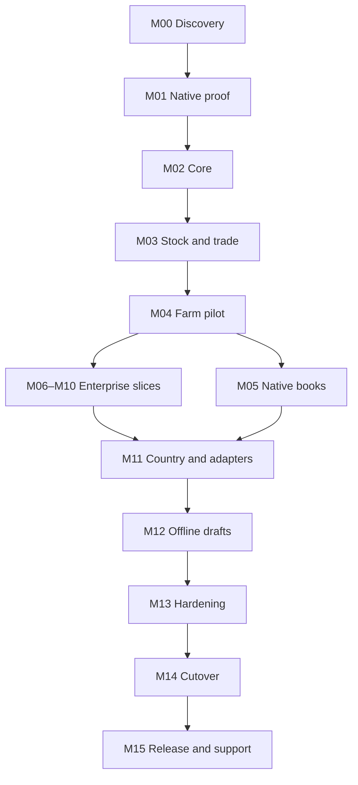

# Delivery roadmap: from JCB source to an operating farm ERP

## 1. Execution contract

Follow this order until the dependency gates permit parallel domain work. Each milestone produces a reviewable commit/PR increment, maintained JCB source, compiled artifacts where applicable, and an evidence receipt. This document is the implementing agent's task plan; none of its implementation checkboxes is already passed by the research PR.

The [structured roadmap](contracts/roadmap.json) provides stable IDs/dependencies. The [acceptance registry](contracts/acceptance-cases.json) contains the detailed test backlog with `not_run` initial status. Farmer scenarios are in [regional scenarios](research/FARM_OPERATING_SCENARIOS.md) and [ERP patterns](research/ERP_WORKFLOW_PATTERNS.md).

### Every vertical slice follows the same sequence

1. Read its relevant skill/model contract and authoritative source at the target version.
2. Select a complete reusable JCB feature; document reuse/adaptation/new identities.
3. Author owned Fields, Admin Views, child entities, component associations, queries, Templates/Layouts, actions and needed Powers.
4. Acquire/save/reopen and verify the actual persisted JCB graph.
5. Compile, inspect relevant SQL/PHP/routes/assets, install, and exercise a real caller with a non-Super-User account.
6. Prove positive, denied, malformed, retry/correction and relevant concurrency cases.
7. Export complete source/dependencies; rebuild from a fresh JCB environment; retain installer/source/artifact checksums and receipt.
8. Commit source and evidence. Fix lasting defects in JCB source, never only in generated files.

Do not build all tables first and postpone real workflows until the end. Do not make the next agent infer missing ownership or transaction behaviour from screen mockups.

## 2. Milestone dependency map

M06–M10 have independent domain owners and may be developed in parallel after M04 stabilises shared contracts, including in operational/export mode before native books activate. Native accounting remains required for the full ERP exit. One controller owns each Playground. The JSON registry contains exact dependencies; all required features must converge before general release. Country verification begins at M00 and repeats before each regulated feature; M11 is cross-country completion, not permission to skip earlier checks.

## 3. Detailed work packets

### M00 — confirm the first farm and resolve the toolchain

**Depends on:** this research package. **Release:** R0. **Owner:** lead agent + farmer/product owner.

- Read the complete Skills entrypoints and this roadmap. Record new upstream changes from the researched snapshot without assuming historical hashes are install targets.
- Confirm legal entity, pilot country, farms/locations, enterprises, users/roles, devices/connectivity, hosting/support owner, existing accounting process, products/units, animal identification practice and source records.
- Discover current stable JCB/Joomla/PHP/database targets and the actual supported authoring/compile/export interfaces. Read the relevant `AGENTS.md` instructions in future source repositories.
- Establish authorised source repositories/branches for package definitions and project Powers, keeping their native contracts; research remains in `doc-test`. Avoid creating a second documentation/source system without a purpose.
- Resolve one meaningful pilot flow: feed receipt → feed issue to a herd/enterprise → animal observation → expense/cash evidence → accountant export. Choose synthetic fixtures before real data.
- Record country-sensitive activations (invoices/tax, movement, hunting, food, employment) and the responsible reviewer. Discover data without demanding irrelevant documents prematurely.

**Output:** discovery decisions, environment/provenance receipt, initial source ownership map, pilot dataset and acceptance selection.

**Exit gate:** the agent knows what it is building, for whom, where, with which versions and which real-data/publication authorisation. Unknown business configuration remains visible; independent synthetic development continues.

### M01 — prove native generation, shared services and transactions

**Depends on:** M00. **Release:** R0. **Owner:** JCB/architecture lead.

- Author minimal Core and Ledger roots through JCB, each with a concrete owned entity and real frontend/administrator caller. Prove the owner-model/Power bridge or another genuinely supported native method.
- Add a minimal Livestock participant before claiming the three-owner domain → Ledger → Core transaction is proved. Two components establish the bridge; three establish the real posting path.
- Inspect the actual generated provider, namespace placement, autoloaders, API inventory, SQL indexes and Joomla Table/asset mutation paths.
- Prove a single driver/connection, one outer transaction, unique command receipt, source-effect uniqueness and rollback after each participating write. Repeat requests and contend for the same test balance. Use a minimal Livestock event plus feed issue so this proof does not require building full manufacturing first.
- Test decimal/date handling in browser and native target. Prove a canonical non-null balance key, creation races and a stable capacity-lock strategy using real engine behaviour.
- Compile/install without JCB at runtime; exercise denied access, API exposure, custom methods, immutable tables and missing/incompatible dependencies.
- Export source and complete-site archive; reacquire/rebuild in a clean JCB site and independently restore the archive.

**Output:** small working reference slice, tested service bridge, release manifest skeleton, exact proof receipt and resolved P0 risks.

**Exit gate:** no unresolved shared runtime/atomicity/API/source-rebuild blocker. If the native approach fails, document the smallest supported correction and prove it before expanding. Do not author dozens of components around unverified wiring.

### M02 — build Core and the daily workspace

**Depends on:** M01. **Release:** R1. **Owner:** Core team.

- Author organisation, farm, location, enterprise, party/roles/contacts/addresses, products, units/conversions, currency/rates, vocabularies and user scope.
- Reuse the complete managed Files/File Types feature, enforcing owner-level private downloads and original-document retention where required.
- Add controlled number series, audit, command receipts, outbox, import staging, approvals and country-pack records. Create only infrastructure needed by current commands.
- Build Farm Desk, farm selector, quick capture shell and capability-aware navigation using Site Views/Dynamic Gets/Templates/Layouts.
- Seed synthetic reference values with preserved application GUIDs; no real tax rates/wage rules copied from unreviewed pages. Record initial-data source and prove fresh installation.
- Configure role templates without fixed Joomla group IDs. Verify cross-farm restrictions in selectors, direct forms, exports, API and file access.

**Output:** usable shared masters, scoped workspace, private document flow and testable infrastructure.

**Exit gate:** saved/reopened records and relations are correct; duplicate/malformed identifiers rejected; revoked users cannot retrieve old results; fresh source rebuild reproduces seeded state.

### M03 — establish stock, procurement and sales

**Depends on:** M02. **Release:** R1. **Owner:** Ledger team.

- Author stores/bins/lots, stock entries/balances/reservations/valuation, trade documents/lines/tax snapshots, payments/allocations and cash sessions.
- Implement receive, reserve, issue, transfer, count adjustment and reversal commands with decimal units, locks, nonnegative availability, immutable source effects and moving-average valuation.
- Implement purchase order → partial receipt → bill evidence and quote/order → delivery → invoice/payment evidence. Financial mode determines whether native journals are required.
- Build farmer-market sale/cash-close workflow; distinguish card/bank settlement from cash and deposits from earned revenue.
- Export controlled source records to the accountant. Use approved pilot-country tax/document settings before issuing live documents; otherwise keep documents clearly in draft/sandbox state.
- Reconcile stock quantities/value, document outstanding balances, allocations, cash and export totals. Prove retried imports do not duplicate them.

**Output:** a stock/trade foundation shared by every enterprise, with complete sources and ledgers.

**Exit gate:** no partial transfer, negative availability, duplicate post, mutable issued document, unallocated unexplained payment or non-null-key race. Accountant accepts the export schema/sample.

### M04 — operate a limited farm pilot

**Depends on:** M03. **Release:** R1 exit. **Owner:** lead + Livestock/Work + farmer.

- Add minimal Animal/Identifier/Event/Weight and farm tasks/worker assignment. Use individual or counted-group policy deliberately and avoid double counting.
- Connect feed issues, herd/enterprise cost attribution and normal expense capture to Ledger. Existing medicine documents may be attached as evidence; live treatment/restriction-dependent operations require the M06 control slice first, even if delivered early for this pilot.
- Complete the chosen end-to-end pilot flow with a useful Today screen and printed/exported outputs.
- Import a small reviewed sample, reconcile counts/stock/values, and train the farmer plus a capture user.
- Run one controlled operating period with the established external accountant remaining the statutory authority. Record real usability problems and source-correct them.
- Prove backup/restore and critical role denials before allowing business data. A pilot release has a clear feature/country/financial-mode manifest.

**Output:** a useful farm application with limited scope and operational/export accounting mode.

**Exit gate:** farmer can complete daily actions; accountant receives reconcilable exports; no unresolved critical integrity/security/recovery defect. R1 completion does not claim the full ERP is finished.

### M05 — activate native accounting

**Depends on:** M04. **Release:** R2. **Owner:** Ledger team + accountant.

- Author chart/periods, journal headers/lines, bank statement staging/matches, native AR/AP, tax snapshots, budgets and financial assets/depreciation.
- Implement posting templates, receipt accrual/variance, sale/COGS, credit/refund, deposit liability, payment allocation, FX and period locks through owner commands.
- Add manual journal permissions/approval; restrict control-account adjustments to approved workflows.
- Implement trial balance, profit/loss, balance sheet, ageing, bank/cash, inventory reconciliation and enterprise costs with source drill-down.
- Test full/partial payments, overpayments, returns, backdated corrections, multi-currency settlements, rounding, locked-period races and depreciation duplicates.
- Stage cutover with approved opening balances, inventory valuation, AR/AP detail, banks, deposits and assets. Freeze historical export boundaries and document the native-mode transition.

**Output:** tested double-entry ledger and financial reports for the approved pilot jurisdiction.

**Exit gate:** accountant signs representative statements/control reconciliations; all posting paths enforce the same rules; native mode cannot be disabled with a casual settings change.

### M06 — complete livestock operations

**Depends on:** M04; M05 only for native accounting effects. **Release:** R3. **Owner:** Livestock team.

- Extend births/parentage/breeding, replacement tags, group membership/count events, weights, acquisition/sales, mortality, movements and location history.
- Add treatment targets, product/lot consumption, authorised instruction evidence and independent output-specific restriction records. Meat/milk/movement restrictions and overlapping treatments must retain their own intervals and releases; no automatic medical advice or general override of legal restrictions.
- Preserve external official identifiers/permit evidence with reviewed import/export. Do not invent NamLITS/BAITS API calls.
- Implement individual quantity-one lot linkage only where the chosen stock policy uses it; reconcile animal status and Ledger count without double recognition.
- Add herd head-count roll-forward, reproductive/weight summaries, feed costs and missing/expired evidence reports.

**Output:** complete animal/group lifecycle with traceable costs and movement restrictions.

**Exit gate:** purchased + births + transfers in − sales − deaths − transfers out reconciles to final count; individual/group conversion is explicit and idempotent; active restrictions block relevant commands.

### M07 — implement crops, gardens and harvest

**Depends on:** M04; M05 only for native accounting effects. **Release:** R3. **Owner:** Crops team.

- Author plots, cycles, cycle-plot allocation, crop/variety vocabularies, observations, inputs/irrigation, harvest lines and grade outputs.
- Allocate exclusive/intercropped areas deliberately; distinguish orchards/perennials and annual cycle accounting.
- Connect inputs, labour references and harvest lots to owner services; confirm harvest restrictions and quality holds.
- Implement cycle cost/harvest yield, grade split, waste and input-usage reports. Missing measurements stay distinct from zero.

**Exit gate:** one harvest creates each lot/quantity/value once; input/harvest failure rolls back the whole event; cycle totals explain graded output and losses.

### M08 — implement woodwork, food and light manufacturing

**Depends on:** M04; M05 only for native accounting effects; Crops/Livestock integration optional through shared lots. **Release:** R3. **Owner:** Make team.

- Author BOM/recipe revisions/lines, work centres, orders/operations, actual material use, outputs, quality specifications/checks, genealogy and recall.
- Implement material reservation, release, completion, independent quality/recall holds and releases, by-product/scrap, rework and approved cost allocation. A routine quality release never clears a recall hold.
- Provide wood templates for grade/dimensions/units and offcuts; food templates for ingredients/packaging/allergen/expiry/process evidence. Optional animal-feed manufacturing uses reviewed feed rules and the same genealogy controls.
- Trace each input lot to outputs and customers. If exact sub-batch assignment is not captured, recall conservatively at the actual batch scope.
- Add production costing, yield/variance and order profitability reports using actual stock and approved labour/overhead inputs.

**Exit gate:** material/output/value reconciles; no phantom by-product value or double wages; held/expired lots cannot be sold; a recall finds affected stock and recipients.

### M09 — implement lodging and hunting

**Depends on:** M04; M05 only for native accounting effects. **Release:** R3. **Owner:** Stay team.

- Author resources/rates, reservation items/claims, guests, hunts, quota/allocation, permit checks, outcomes and trophy evidence.
- Use one physical capacity source across packages. Initially lock existing physical resource rows in sorted GUID order, then inspect overlapping claims; all room/guide/vehicle claims commit together. Implement half-open intervals and hold expiry. Do not introduce an unmodelled per-night lock table as an assumption.
- Connect quotations, deposit liabilities, invoices, cancellations/credits/refunds and package revenue allocations to Ledger.
- Require the correct reviewed country/province/season/species/participant documents before enabling regulated hunt confirmation/outcome operations. A payment or uploaded PDF alone cannot approve a hunt.
- Add calendar, arrivals/departures, housekeeping tasks, document-expiry list and utilisation reports.

**Exit gate:** simultaneous last-room/last-quota requests cannot both succeed; cancellation releases only unused capacity and records correct money treatment; actual hunt outcomes cannot disappear through cancellation.

### M10 — complete workforce, equipment and farm infrastructure

**Depends on:** M04; M05 only for native accounting effects. **Release:** R3. **Owner:** Work team.

- Author engagements, skills, crews/membership, assignments, attendance/time, leave and payroll exports with HR privacy.
- Author assets, maintenance plans/jobs, meter readings, fuel issues, water points/readings, rainfall, inspections and incidents.
- Connect parts/fuel through Ledger; keep operational asset life separate from financial depreciation. Stay owns booking claims on guides/vehicles; Work supplies optional qualification/availability facts.
- Implement service reminders, meter resets, breakdown workflow, task costing, water/fuel exceptions and approved staff exports.
- Test payroll exports against the actual provider/accountant schema. Statutory payroll computation remains an optional later country-specific release, not a silently incomplete feature.

**Exit gate:** approved time and stock costs are not duplicated; private employment fields remain restricted; maintenance can be traced from fault to parts/cost/outcome; export corrections have revision history.

### M11 — complete the three country packs and external handoffs

**Depends on:** M05 and M06–M10 for the affected features. **Release:** R4. **Owner:** regional configuration lead + local reviewers.

- Verify NAD/ZAR/BWP currency/rounding/FX behaviour, country/subjurisdiction choices, document identities and required terminology.
- Resolve the source contradictions recorded in regional research against current instruments and commencement. Store approved version/effective dates/evidence, not just a current rate.
- Validate tax, tourism, livestock movement, hunting, food/feed, employment/privacy and retention capabilities separately for Namibia, South Africa and Botswana.
- Implement only documented adapters: accountant/bank files first, optional provider/API adapters with real contracts and sandbox evidence.
- Run a representative transaction/operation set for every enabled country/feature and verify invoice/export formats with its reviewer.

**Exit gate:** unsupported capabilities are visibly disabled. Claim readiness per country/capability, never blanket regional legal compliance.

### M12 — add bounded offline observation capture

**Depends on:** M11 and stable server commands. **Release:** R4. **Owner:** frontend + Core.

- Select actual low-risk field drafts based on pilot need: weights, rainfall, task progress and notes.
- Implement device-local queue, persistent request keys, explicit sync status, reconnect/re-authentication, expiry/purge and conflict review.
- Revalidate current scope, identity, unit and aggregate version on the server. Reject final stock, money and reservation posting offline.
- Test lost connectivity before/after commit, duplicate upload, stale record, revoked user, clock skew, shared/lost device and cleared storage.

**Exit gate:** no duplicates or silent overwrite; farmer can tell what is saved only locally; restricted documents and administrative tokens are not cached.

### M13 — harden the full installation

**Depends on:** M06–M12. **Release:** R4. **Owner:** independent test/security/operations reviewers.

- Run complete positive and negative role tests across frontend, admin, API, selectors, bulk actions, imports and private downloads.
- Run native database concurrency/crash-recovery tests, quality/recall and all financial/stock reconciliation cases.
- Benchmark representative data volume and concurrent users; inspect slow queries/indexes and measure response percentiles.
- Verify translation, keyboard/touch usability, inaccessible/empty/error states and chosen browsers/devices.
- Test fresh install, representative upgrade, disabled optional modules, dependency rejection, source rebuild and independent site restore.
- Review licence/dependency notices, source provenance, secret handling, logs, job scheduling and support diagnostics.

**Exit gate:** all required tests pass with receipts; no unresolved critical/high data-integrity or unauthorised-access defect; any accepted lower-risk limitation has owner and user-visible impact.

### M14 — rehearse and execute farm cutover

**Depends on:** M13. **Release:** R4. **Owner:** lead + farmer + accountant + host operator.

- Follow [migration/runbook](SECURITY_OPERATIONS_AND_MIGRATION.md): source inventory, staged mapping, dry-run, reconciliation, backup, final delta and controlled opening.
- Validate opening head counts, stock/value, AR/AP, banks/cash, deposits, future room claims, permits and documents.
- Train each role on its real work, corrections, warnings and recovery procedure. Run a realistic day including an error and an interruption.
- Measure recovery point/time and confirm operating contacts. Keep outbound adapters disabled in rehearsal and deduplicated at activation.

**Exit gate:** signed reconciliations, tested fallback, usable role workflows and explicit authority to switch the live farm. Synthetic research/test authorisation is not live migration authorisation.

### M15 — publish the supported release and maintain it

**Depends on:** M14. **Release:** R4 exit. **Owner:** release/support owner.

- Deliver exact installers, editable source graphs, manifests/checksums, country capability matrix, evidence, known limitations, operations and training material.
- Complete independent-agent reproduction: a different agent installs/imports/builds and performs representative workflows from the handoff alone.
- Verify supported upgrades, backups, scheduled jobs, alert routing and the agreed early-life support review.
- Record measured usability/reliability/reconciliation outcomes and convert concrete defects into a prioritised maintenance backlog.

**Exit gate:** the farmer can operate the agreed system and a maintainer can rebuild/recover it. Merge/release/deploy follow the user's actual authorisation; passing tests alone is not permission to merge someone else's branch.

## 4. Parallel work and review ownership

After M01–M04 stabilise operational contracts, assign domain owners for M05–M10, plus a reviewer for Ledger effects and access. Enterprise slices can operate with accountant export while M05 is completed. Use separate source branches/worktrees or genuinely isolated authoring sites. Shared model changes require an owning integrator; do not copy a shared Field into an independent identity by accident.

One agent controls a live Playground's writes. Other agents can research, inspect sources, write acceptance cases and review exported diffs concurrently. Integrate one slice at a time and rerun affected contract checks. Report conflicts as source-model changes, not manual generated-code merges.

Each change describes problem, source records changed, resulting behaviour, actual verification and remaining risk. Prefer small coherent commits such as “receive feed with lot traceability and rollback” over broad autogenerated dumps without evidence.

## 5. Planning and affordability

Do not promise a full regional ERP in a few automated sessions. JCB can reduce repetitive generation; domain integrity, country verification, migrations and real-user testing remain substantive work. Estimate calendar/cost after M01 and M04 using measured throughput, actual integrations and the farmer's priorities.

The bounded pilot avoids requiring every enterprise at once. If cost/time is constrained, preserve complete working slices and defer whole optional capabilities. Do not remove reconciliation, access control, source reproducibility or backup to meet a date. Record which release/country capabilities are complete, planned or blocked; “complete ERP” means the agreed release gates, not the existence of many menu items.
